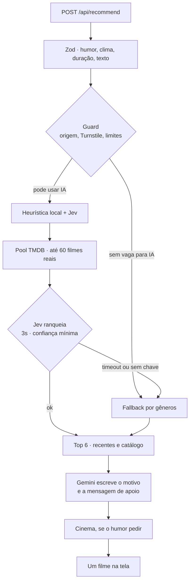

<p align="center">
  
</p>

<h1 align="center">Pick One</h1>

<p align="center">
  <strong>Me fala o que sente, me fala o que quer sentir,<br/>e eu te recomendo um filme baseado nisso.</strong>
</p>

<p align="center">
  Um filme. Para o humor de agora, para o tempo que você tem.<br/>
  PWA mobile-first em português, feito com Next.js 15 e React 19.
</p>

<p align="center">
  <a href="LICENSE"></a>
  
  
  
  
  
  
  
</p>

<p align="center">
  <a href="#como-funciona">Como funciona</a> ·
  <a href="#começar">Começar</a> ·
  <a href="#variáveis">Variáveis</a> ·
  <a href="#por-dentro">Por dentro</a> ·
  <a href="#pwa">PWA</a> ·
  <a href="#licença">Licença</a>
</p>

---

## O clima de hoje

Quinze humores. Cada um pinta o fundo, escolhe os gêneros e decide o quanto a indicação precisa acolher.

<table>
  <tr>
    <td align="center"><br/><sub>Arrasado</sub></td>
    <td align="center"><br/><sub>Triste</sub></td>
    <td align="center"><br/><sub>Ansioso</sub></td>
    <td align="center"><br/><sub>Estressado</sub></td>
    <td align="center"><br/><sub>Cansado</sub></td>
  </tr>
  <tr>
    <td align="center"><br/><sub>Entediado</sub></td>
    <td align="center"><br/><sub>Solitário</sub></td>
    <td align="center"><br/><sub>Normal</sub></td>
    <td align="center"><br/><sub>Feliz</sub></td>
    <td align="center"><br/><sub>Apaixonado</sub></td>
  </tr>
  <tr>
    <td align="center"><br/><sub>Nostálgico</sub></td>
    <td align="center"><br/><sub>Reflexivo</sub></td>
    <td align="center"><br/><sub>Aventureiro</sub></td>
    <td align="center"><br/><sub>Querendo um susto</sub></td>
    <td align="center"><br/><sub>Extraordinário</sub></td>
  </tr>
</table>

Os emojis animam na tela (e ficam quietos se o sistema pedir menos movimento). No README eles aparecem na versão estática.

---

## Como funciona

Quatro passos, uma barra de progresso, um filme.

| | Etapa | O que você faz |
| --- | --- | --- |
| **01** | **Humor** | Escolhe o que mais se aproxima de agora. |
| **02** | **Clima** | Mantém o clima ou pede para mudar. Se quiser, conta um pouco mais, em até 200 caracteres. |
| **03** | **Duração** | Curtinho, padrão, longo, tanto faz, ou um mínimo e um máximo. |
| **04** | **Resultado** | Um filme, o motivo, onde assistir, e a opção de pedir outro. |

No resultado cabem:

- pôster, ano, duração, nota e sinopse
- **Por que esse filme**, escrito para o seu momento
- uma mensagem de companhia quando o humor pede acolhimento
- onde assistir no Brasil, em streaming ou aluguel
- **Outro filme**, recomeçar, compartilhar e o trailer
- um convite para o cinema, com **Ver sessões** ou **Prefiro ficar em casa**
- o CVV 188, só quando o momento está realmente pesado

> [!NOTE]
> **Outro filme** circula entre os títulos que já vieram na mesma busca. O histórico fica no aparelho, para a próxima indicação não repetir o que você acabou de ver.

---

## Começar

Node `24` (tem um `.nvmrc` na raiz) e [pnpm](https://pnpm.io).

```bash
pnpm install
cp .env.example .env.local   # preencha TMDB_TOKEN
pnpm dev
```

| Comando | Faz |
| --- | --- |
| `pnpm dev` | Sobe o app em desenvolvimento |
| `pnpm build` | Gera o build e o service worker |
| `pnpm start` | Serve o build |
| `pnpm lint` | Roda o ESLint |

> [!IMPORTANT]
> Só o `TMDB_TOKEN` é obrigatório. Sem chave de IA, sem Upstash e sem Turnstile, o app indica filme do mesmo jeito: o fallback por gêneros, com cache em memória.

---

## Variáveis

Cada chave liga uma camada sozinha. O modelo está em [`.env.example`](.env.example).

| Variável | Liga |
| --- | --- |
| `TMDB_TOKEN` | Filmes. Obrigatório. Read Access Token v4, com ou sem `Bearer`. |
| `TYPESAFE_API_KEY` | Jev: lê o texto livre e ranqueia os candidatos. |
| `GOOGLE_GENERATIVE_AI_API_KEY` | Gemini: escreve o “por que esse filme” e a mensagem de apoio. |
| `UPSTASH_REDIS_REST_URL` / `UPSTASH_REDIS_REST_TOKEN` | Cache, limite por IP e teto diário. **A IA só roda com Redis.** |
| `NEXT_PUBLIC_TURNSTILE_SITE_KEY` / `TURNSTILE_SECRET_KEY` | Cloudflare Turnstile invisível. |
| `GEMINI_MODELS` | Modelos do Gemini, tentados em ordem. Padrão: `gemini-3.5-flash-lite,gemini-flash-lite-latest,gemini-3.5-flash`. Se todos falharem, o Jev escolhe motivos curados. |
| `AI_DAILY_LIMIT` | Teto global de indicações por IA por dia. Padrão: `800`. |
| `ALLOWED_ORIGINS` | Origens extras aceitas pela API, separadas por vírgula. |
| `ALLOW_AI_WITHOUT_REDIS` | Só em desenvolvimento. Libera a IA sem Redis. Em produção é ignorada. |

Os números que mudam o gosto da indicação, sem mexer em lógica, moram em [`src/config/recommend.ts`](src/config/recommend.ts) (`RECENT_RATIO`, `RECENT_MONTHS`, limites, TTLs) e em [`src/config/moods.ts`](src/config/moods.ts) (humores, gêneros, `sadness`, `cinemaWeight`).

---

## Por dentro

`POST /api/recommend` valida o corpo com Zod e entrega para [`src/server/recommend.ts`](src/server/recommend.ts).



1. **Guard** ([`guard.ts`](src/server/guard.ts)). Origem, Turnstile, limite por IP (5 por dia, 3 por minuto) e teto global diário. Qualquer falha devolve filme pelo fallback.
2. **Leitura do texto.** A heurística local ([`ai/heuristics.ts`](src/server/ai/heuristics.ts)) sempre roda: abuso, jailbreak e `sadness`. O Jev refina quando está disponível. Vale o maior `sadness`.
3. **Pool** ([`candidates.ts`](src/server/candidates.ts)). Até 60 filmes reais do TMDB, cerca de 40% lançados nos últimos 18 meses e o resto de catálogo, já com duração, em cache.
4. **Ranking.** Jev, com timeout de 3 segundos e confiança mínima, ou o fallback por gêneros ([`fallback.ts`](src/server/fallback.ts)).
5. **Top 6** ([`select.ts`](src/server/select.ts)). Respeita a cota de recentes sem forçar um lançamento fraco, e varia as épocas.
6. **Textos.** O Gemini escreve só o `reason` e a mensagem de apoio, depois do ranking, com limite de tamanho e uma lista de palavras proibidas. Se ele não responder, entram as frases de [`src/config/messages.ts`](src/config/messages.ts).
7. **Cinema.** Em humores tristes, ou na chance do `cinemaWeight`, um filme leve em cartaz no Brasil. Dá para ver as sessões ou ficar em casa. O CVV 188 aparece só quando `sadness = 2`.

A IA escreve sobre filmes que o TMDB já devolveu. Título, pôster, elenco de onde assistir e trailer vêm do catálogo.

Os provedores ficam atrás das interfaces de [`src/server/ai/types.ts`](src/server/ai/types.ts): `TextReader`, `Ranker` e `CopyWriter`.

### Jev

[`src/server/ai/jev.ts`](src/server/ai/jev.ts) chama `POST https://api.typesafe.ai/v1/systemone` ([documentação](https://docs.typesafe.ai/api)). A leitura do texto usa perguntas `choice` (humor), `score` (`sadness`) e `noul` (abuso). O ranking faz uma pergunta `noul` por candidato.

### Anti-abuso

1. Chaves só no servidor. Nada de `NEXT_PUBLIC_`, fora a site key do Turnstile.
2. Turnstile invisível: sem token válido, a requisição não chega na IA.
3. Limite por IP: passou da cota, a pessoa ainda recebe um filme pelo fallback.
4. Teto global diário, num contador do Redis que expira à meia-noite de Brasília.
5. Cache do pool e do ranking sem texto livre, por 12 horas.
6. Texto classificado como abuso não chega no Gemini.
7. Validação estrita: Zod, corpo de até 4 KB, texto de até 200 caracteres, humor como enum, checagem de Origin.
8. **Outro filme** reaproveita o top que já foi buscado.
9. No dia a dia: limite de gasto e alerta no console da TypeSafe, cota no Google AI Studio e, se o Gemini for para o tier pago, alerta e limite lá também.

---

## PWA

O app instala na tela de início. O manifesto está em [`src/app/manifest.ts`](src/app/manifest.ts), os ícones saem de `/icons/*` e do `apple-icon`, e o service worker usa Serwist ([`src/sw.ts`](src/sw.ts)).

| Em cache | Sempre na rede |
| --- | --- |
| assets, emojis e pôsteres | `/api/*` |

Tem página [`/offline`](src/app/offline/page.tsx) para quando a rede some. O service worker só é gerado no `pnpm build`. O `pnpm dev` sobe sem ele.

---

## Mapa do código

```text
src/
├── app/                página, manifesto, ícones, /offline e /api/recommend
├── components/flow/    humor, clima, duração e resultado
├── config/             humores, frases de acolhimento e limites
├── lib/                tipos, schema, histórico e Turnstile
├── server/             recomendação, TMDB, cache, guard e IA
│   └── ai/             heurística, Jev e Gemini
└── state/              estado do fluxo
public/emoji/           Noto Emoji, animado em .webp e estático em .svg
```

---

## Créditos

Emojis animados: [Noto Animated Emoji](https://googlefonts.github.io/noto-emoji-animation/), do Google, licença [CC BY 4.0](https://creativecommons.org/licenses/by/4.0/). Na tela eles animam; com `prefers-reduced-motion`, entra o SVG estático.

Dados de filmes: [TMDB](https://www.themoviedb.org/). Este produto usa a API do TMDB, mas não é endossado nem certificado por ela.

Feito por [Henrique Tavares](https://github.com/tavareshenrique).

---

## Licença

[MIT](LICENSE) © 2024–2026 Henrique Tavares.
